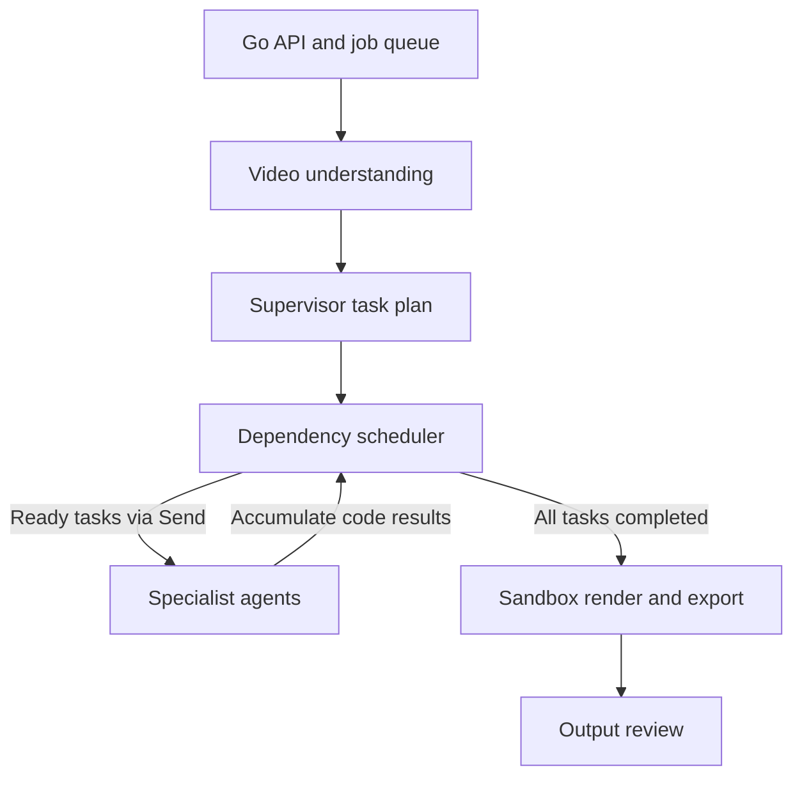

# Agentic Video Editor — Free Nemotron + LangGraph MVP

A working local, multi-agent video editor. The Go service accepts uploads and asynchronous jobs through a REST API. A Python LangGraph system uses BLIP to understand the footage, NVIDIA Nemotron through OpenRouter to create and route a creative plan, specialist agents to write restricted Python editing code, and FFmpeg/OpenCV/faster-whisper to execute and review the result.

This is genuinely AI-planned: there is no rules parser in the orchestration decision path. `OPENROUTER_API_KEY` is required for a job. Nemotron is the preferred model brain; LangGraph is the workflow engine that coordinates the agents. Every configured model is free. OpenRouter automatically moves through the ordered fallback chain when a model is unavailable, rate-limited, or refuses the request.

## Architecture



The specialist fan-out is dependency-driven. The supervisor selects tasks and declares `depends_on` IDs. A scheduler sends only ready tasks through LangGraph `Send`, so independent specialist calls run concurrently. At each wave boundary their outputs are accumulated in shared state; dependent agents receive their direct predecessors' generated code and rationale before starting. Export depends on every other task. Once all tasks finish, their code is combined in plan order and passed to the sandbox exactly once.

For example, independent editing and music decisions can run together. An animation agent that needs the editing agent's final timing waits for editing and receives its code. Export waits for editing, music, and animation. A fully chained plan runs sequentially; a plan with independent tasks runs those tasks concurrently. LangGraph schedules in waves, so a new wave waits for every agent in the current wave.

Concurrency applies to specialist **code generation**, not FFmpeg mutations of the same video. Media operations run sequentially in the sandbox, followed by output review. Dependency outputs describe planned operations; they are not rendered intermediate videos. The supervisor must declare timing dependencies when cuts or speed changes affect subsequent captions or animation.

Plans reject duplicate IDs, missing/forward/self dependencies (and therefore cycles), and missing/multiple/non-final export tasks. Task list order is the deterministic rendering order, and dependencies must reference earlier tasks. Agent failures stop the graph before rendering. The response exposes each task's `depends_on` in operation parameters.

Run orchestration tests without model/API access:

```bash
python -m pytest worker/tests/test_graph.py -q
```

Tests cover actual overlap using a thread barrier, dependent context, final joining, long sequential plans, invalid graphs, and failed agents.

## Agent and tool inventory

| Agent | Role | Tools it can generate |
|---|---|---|
| Video understanding | Understand scenes and timing | OpenCV frame sampling, BLIP captions, ffprobe |
| Supervisor | Plan and route based on context | Nemotron structured output + LangGraph `Send` fan-out |
| Editing | Assemble and pace footage | `merge`, `trim`, `cut`, `transition`, `crop`, `speed`, `color_grade` |
| Music | Select and mix a soundtrack | `select_music`, `add_music`, FFmpeg `amix` |
| Subtitles | Transcribe or add captions | faster-whisper, SRT generation, FFmpeg subtitle burn-in |
| Animation | Add tasteful motion/graphics | `add_text`, `zoom`, `fade` |
| Export | Encode delivery file | MP4/MOV/MKV/WebM, resolution, CRF, thumbnail |
| Review | Inspect the rendered output | BLIP re-analysis + Nemotron QA score/notes |

Adding a tool means implementing one capability method in `agent_runtime.py`, adding it to the sandbox allow-list, and describing its signature to the relevant specialist. The supervisor is not limited to a hard-coded sequence.

## Generated-code sandbox

Nemotron generates real Python statements such as:

```python
editor.transition(name="dissolve", duration=0.8)
editor.color_grade(brightness=0.03, contrast=1.08, saturation=1.12)
editor.select_music(mood="uplifting cinematic", volume=0.18)
editor.transcribe_subtitles(language="en")
editor.add_text(text="Build. Learn. Ship.", start=0, end=3, position="center")
editor.export(filename="reel.mp4", width=1920, height=1080, crf=21)
```

Before execution, the sandbox parses the code into an AST. It rejects imports, variable access, loops, functions, arbitrary attributes, positional/dynamic arguments, file access, and every method outside the capability registry. It then runs the trusted wrapper in a child process with a timeout and, on Linux/Docker, CPU/file-descriptor/memory limits.

This is appropriate for a local MVP and interview demo. It is not a hostile multi-tenant security boundary; production should run generated programs in disposable network-disabled microVMs/containers under a dedicated user.

## Folder structure

```text
.
├── cmd/orchestrator/main.go
├── internal/
│   ├── api/server.go              # Go REST API and uploads
│   ├── config/config.go
│   ├── jobs/                      # channel, goroutines, status store
│   └── worker/client.go           # Go → Python agent REST client
├── worker/app/
│   ├── main.py                    # FastAPI
│   ├── graph.py                   # LangGraph state and routing
│   ├── agents.py                  # BLIP and OpenRouter/Nemotron agents
│   ├── sandbox.py                 # AST/code subprocess sandbox
│   ├── agent_runtime.py           # editing capability/tool registry
│   ├── media.py                   # low-level FFmpeg/OpenCV operations
│   └── models.py                  # structured agent/API schemas
├── worker/tests/
├── assets/music/                  # local royalty-free music library
├── uploads/                       # input video/audio/SRT
├── work/<job-id>/                 # frames, code, intermediate renders
├── outputs/                       # final videos + thumbnails
├── compose.yaml
└── .env.example
```

## Prerequisites

- Free OpenRouter API key
- Docker Desktop (easiest), or Go 1.22+, Python 3.11+, FFmpeg/ffprobe
- First AI job needs internet to download the BLIP and Whisper model weights. Docker preserves them in the `model-cache` volume.

BLIP and Whisper run locally. Only structured text—the user prompt, BLIP captions/timestamps, plans, and tool code—is sent to OpenRouter; raw video is not uploaded by this pipeline.

## Docker run

Copy the environment file and put in your key:

```powershell
Copy-Item .env.example .env
notepad .env
```

Set at minimum:

```dotenv
OPENROUTER_API_KEY=your-free-key
OPENROUTER_MODEL=nvidia/nemotron-3.5-super-vl:free
OPENROUTER_FALLBACK_MODELS=xingchen-agi/xing4.0-29b-a4b:free,dots-studio/dots-3-note-preview:free,openrouter/free
OPENROUTER_BASE_URL=https://openrouter.ai/api/v1
```

Then:

```bash
docker compose up --build
```

- Go API: `http://localhost:8080`
- FastAPI docs: `http://localhost:8000/docs`

The initial image/model setup is large because it includes PyTorch, BLIP, and faster-whisper.

## Native Windows run

Install Go, Python, and FFmpeg, then from the project root:

```powershell
python -m venv .venv
.\.venv\Scripts\Activate.ps1
python -m pip install --upgrade pip
python -m pip install -r worker\requirements.txt
$env:OPENROUTER_API_KEY = "your-free-key"
python -m uvicorn worker.app.main:app --reload --port 8000
```

In a second PowerShell terminal:

```powershell
$env:WORKER_URL = "http://localhost:8000"
$env:JOB_WORKERS = "2"
go run .\cmd\orchestrator
```

Health check:

```powershell
Invoke-RestMethod http://localhost:8080/healthz
```

## End-to-end REST usage

Upload one or more videos:

```bash
curl -F "file=@clip1.mp4" http://localhost:8080/api/v1/uploads
curl -F "file=@clip2.mp4" http://localhost:8080/api/v1/uploads
```

Submit a creative job. This returns `202` immediately because a Go goroutine processes it asynchronously:

```bash
curl -X POST http://localhost:8080/api/v1/jobs \
  -H "Content-Type: application/json" \
  -d '{
    "prompt": "Understand these clips and make the strongest 30-second cinematic product reel. Remove weak moments, use energetic pacing, tasteful motion titles, automatic English subtitles, and choose uplifting music that fits the scenes.",
    "inputs": ["clip1.mp4", "clip2.mp4"],
    "output": "product-reel.mp4"
  }'
```

Poll and download:

```bash
curl http://localhost:8080/api/v1/jobs/JOB_ID
curl -O http://localhost:8080/api/v1/outputs/product-reel.mp4
```

The completed job JSON exposes the Nemotron plan, selected agents/tools, operation timings, BLIP scene captions, generated Python, and Nemotron review score.

## Music behavior

Put royalty-free tracks in `assets/music/` with descriptive filenames such as `upbeat-corporate-120bpm.mp3`. The music agent uses scene captions and creative direction to choose a mood, and the runtime matches that mood against the library. If the user names a track, upload it and request that exact filename. If the library is empty, automatic music selection is recorded as a skipped tool rather than downloading unlicensed media.

## Sample prompts

- `Analyze this footage and create the best 30-second edit. Pick strong scenes, improve pacing and color, add subtle motion, captions, and suitable music.`
- `Make a high-energy vertical launch reel. Keep the product close-ups, remove dead space, use quick dissolves, bold opening text, automatic English subtitles, and upbeat electronic music.`
- `Turn these interview clips into a calm two-minute documentary sequence. Preserve complete thoughts, add speaker-friendly subtitles, use restrained fades, and select gentle ambient music.`
- `Use song.mp3 exactly. Cut on its energy, create a 1080p montage, and add no subtitles.`
- `Find the weakest sections, remove them, merge the remaining clips naturally, color-grade them consistently, and export a polished portfolio reel.`
- `Only trim from 12s to 40s and export. Do not add music, captions, or animation.`

## Tests

```bash
go test ./...
python -m pytest worker/tests -q
```

The unit suite covers Go asynchronous execution, media helpers, and sandbox escape attempts. A real OpenRouter integration test requires `OPENROUTER_API_KEY`, model downloads, and sample media, so it is intentionally not run in normal CI.

## Configuration

| Variable | Default | Purpose |
|---|---|---|
| `OPENROUTER_API_KEY` | required | OpenRouter credential; free to create |
| `OPENROUTER_MODEL` | `nvidia/nemotron-3.5-super-vl:free` | free supervisor/specialist model |
| `OPENROUTER_FALLBACK_MODELS` | three free fallbacks | ordered failover chain; keep every entry free |
| `OPENROUTER_BASE_URL` | `https://openrouter.ai/api/v1` | OpenAI-compatible OpenRouter endpoint |
| `OPENROUTER_SITE_URL` | `http://localhost:8080` | optional OpenRouter attribution URL |
| `OPENROUTER_APP_NAME` | `Agentic Video Editor` | optional OpenRouter attribution name |
| `BLIP_MODEL` | `Salesforce/blip-image-captioning-base` | local frame-caption model |
| `FRAME_SAMPLE_SECONDS` | `30` | visual sampling interval |
| `WHISPER_MODEL` | `small` | local faster-whisper model |
| `SANDBOX_TIMEOUT_SECONDS` | `1800` | generated program timeout |
| `JOB_WORKERS` | `2` | Go goroutine consumer count |
| `JOB_QUEUE_SIZE` | `100` | buffered channel capacity |
| `WORKER_URL` | `http://localhost:8000` | Python service URL |
| `MEDIA_ROOT` | `.` | shared parent of media directories |
| `MAX_UPLOAD_MB` | `1024` | upload cap |


